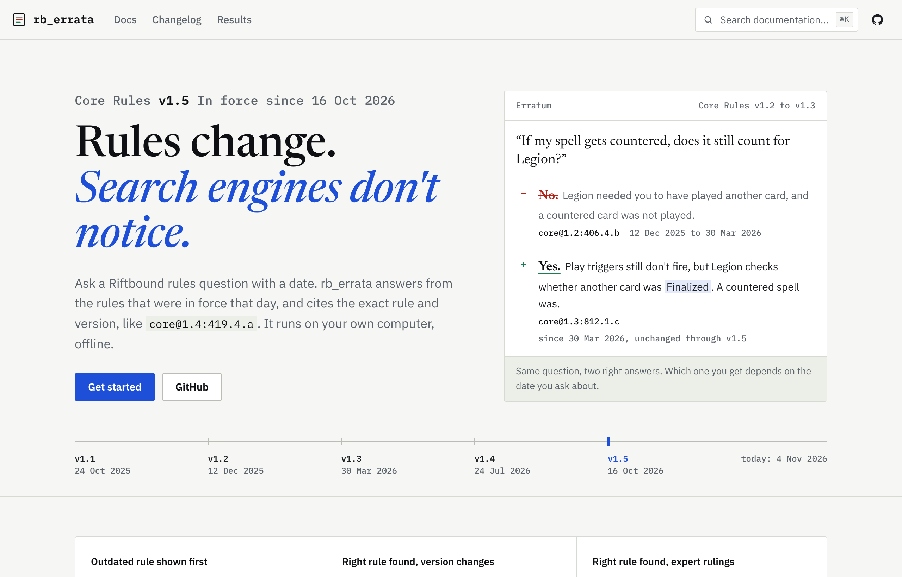
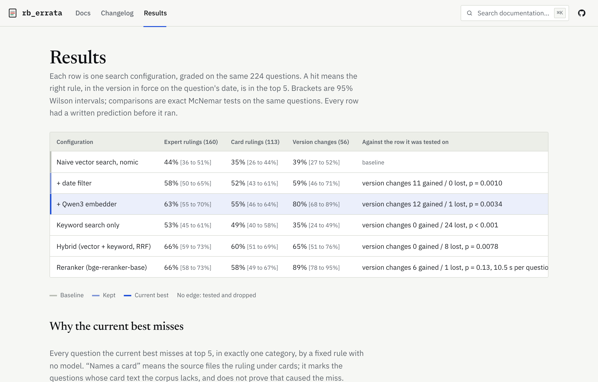
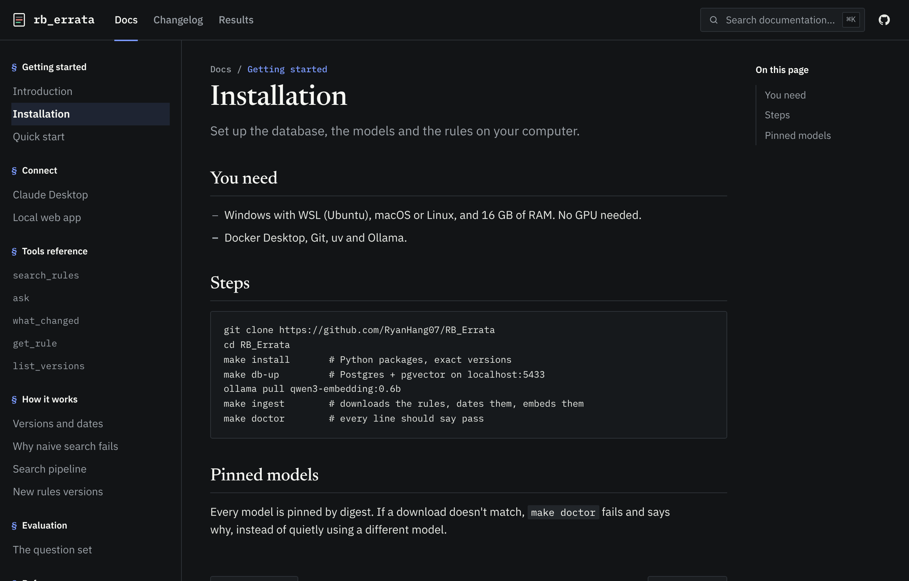

# rb_errata

> rb_errata was created under Riot Games' "Legal Jibber Jabber" policy using assets owned by Riot Games. Riot Games does not endorse or sponsor this project.
>
> rb_errata isn't endorsed by Riot Games and doesn't reflect the views or opinions of Riot Games or anyone officially involved in producing or managing Riot Games properties. Riot Games, and all associated properties are trademarks or registered trademarks of Riot Games, Inc.

A free, open-source rules reference for Riot's Riftbound TCG that answers
**as of a date**. Ask a rules question with a date, and it answers from the
Core Rules version in force that day, citing the exact rule and version
(like `core@1.3:812.1.c`). It runs on your own computer, offline.

Rules change between versions. A plain search engine mixes old and new
wording and can confidently cite a rule that no longer applies. This project
measures that failure on a labelled question set and fixes it with
version-aware search.



## What's built

- **Search and answers by date** over every Core Rules version (v1.1 to v1.5),
  with each version's dates in force.
- **MCP server** for Claude Desktop: `search_rules`, `ask`, `get_rule`,
  `what_changed`, `list_versions`. Every result says which version it came from.
- **Local web app** (`make app`) with the same tools in a browser.
- **Documentation site** (`site/`, not yet deployed).
- **New rules versions** are detected by a weekly check and added with one
  command (`make integrate`).

## Measured

On 224 labelled questions (top 5 results, right rule in the right version):

| | Naive search | Current search |
|:--|--:|--:|
| Outdated rule ranked above the current one (version-change questions) | 28% | 0% |
| Right rule found, version-change questions | 39% | 80% |
| Right rule found, expert rulings | 44% | 63% |

Every number has a written prediction from before the run, including the
wrong ones: [`docs/RECALL.md`](docs/RECALL.md).



## Setup

Needs Windows with WSL (Ubuntu), macOS or Linux, 16 GB of RAM, Docker with
Compose v2, Git, [uv](https://docs.astral.sh/uv/) and
[Ollama](https://ollama.com). No GPU or API key needed.

```bash
git clone https://github.com/RyanHang07/RB_Errata
cd RB_Errata
cp .env.example .env
make install                       # exact versions from uv.lock
make db-up                         # Postgres 17 + pgvector on localhost:5433
ollama pull qwen3-embedding:0.6b
ollama pull qwen3:4b-instruct-2507-q4_K_M
make ingest                        # downloads the rules, dates them, embeds them
make doctor                        # every line should say pass
make app                           # local app on http://127.0.0.1:8765
```

Models are pinned by digest: if a download doesn't match, `make doctor`
fails and says why. Claude Desktop setup: `site/content/docs/claude-desktop.mdx`.



## Design documents

The specification is [`docs/BRIEF.md`](docs/BRIEF.md); its **Amendments**
section overrides the original text. Product surfaces:
[`docs/SURFACE.md`](docs/SURFACE.md).

## Legal

- Riot's rules and card text are **not** stored in this repository or shown
  on the site. Rules PDFs are downloaded from Riot's CDN on your machine and
  verified by hash; only hashes and metadata are committed (see
  [`data/README.md`](data/README.md)).
- Free and non-commercial. No Riot logos, card art or card frames.
- Rulings in the question set are adapted from Riftbound FAQ by Christian
  "Near" Ivicevic, CC BY-SA 4.0.
- How the project meets Riot's policies, clause by clause:
  [`docs/LEGAL.md`](docs/LEGAL.md).
